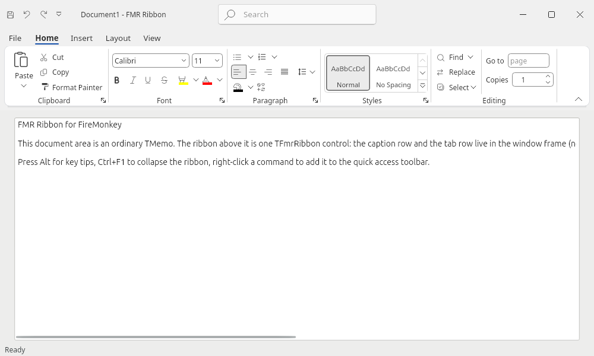

# FMR Ribbon on Linux (FMXWayland)

FMR Ribbon runs on Linux under FMXWayland, a native Wayland backend of FireMonkey written in Object Pascal that
replaces Embarcadero's closed `libfmux` (GTK) — a separate MIT project of the same author; see its `README.md`. FMX draws with its Skia
canvas, windows and popups are Wayland `xdg_toplevel`/`xdg_popup` surfaces. Every runtime unit of the library
compiles with `dcclinux64`; `Demos\RibbonBasic` and `Demos\Showcase` build and run (checked on a headless Weston 14
in WSL, screenshots below).


| | |
|---|---|
|  |  |
| Insert > Cover Page: drop-down gallery (filter, groups, owner-drawn pages, commands, grip) — an `xdg_popup` | The integrated title bar (`/waylandframe=preview`, see [the frame contract](#the-window-frame-contract-ifmxwaylandwindowframe)) |

## Requirements

- Delphi 13 (RAD Studio 37.0) with the Linux platform and FMX for Linux (as for FMXWayland).
- A checkout of FMXWayland (default `f:\Projects\FMXWayland`; `build.ps1 -FmxWayland <folder>` or the environment
  variable `FMXWAYLAND_DIR`). FMR uses its `src`, `src\Protocols`, `tools\gen-fmux-api.ps1` and
  `tools\delphi-env.ps1`; nothing is written into it.
- A Linux platform SDK to link against: FMXWayland's `tools\make-linux-sdk.ps1` makes one from a WSL distribution
  (default `D:\LinuxSDK\ubuntu-22.04`: glibc 2.35; `build.ps1 -Sdk <folder>` or `FMR_LINUX_SDK`).
- At run time: a Wayland compositor (`wl_compositor`, `wl_shm`, `xdg_wm_base`), libwayland-client0, libxkbcommon0,
  fontconfig (always there: `libsk4d.so` links it), `libsk4d.so` and `fonts/FmrFluentIcons.ttf` next to the
  program.
- For the headless checks: a WSL distribution with `weston` (default `Ubuntu-26.04`: Weston 14).

## Building

```powershell
.\build.ps1 -Project Demos\RibbonBasic\RibbonBasic.dpr -Platform Linux64             # Debug
.\build.ps1 -Project Demos\Showcase\Showcase.dpr -Platform Linux64 -Config Release
```

`build.ps1 -Platform Linux64` does what FMXWayland's `tools\build.ps1` does, with FMR's folders:

1. `gen-fmux-api.ps1 -Out dcu\Linux64\gen\FMUX.Api.pas` generates `FMUX.Api` from the local Delphi (the interface is
   Embarcadero's code: generated, never committed; `dcu\` is ignored). `Find-FmxLinux` of `delphi-env.ps1` picks the
   FMX for Linux units (product or GetIt package) and the matching `FMUX.Api.pas`.
2. The unit path starts with `dcu\Linux64\gen`, `<FMXWayland>\src`, `<FMXWayland>\src\Protocols`, so the compiler
   takes the generated `FMUX.Api` instead of Embarcadero's precompiled one; then every folder of `Source\` except
   `Source\Design` (VCL, design time), the project folder, the FMX for Linux units and `lib\linux64\<config>`.
3. Delphi 13 has no Linux64 `FMX.Filter.res` (FMX.Filter links it): the Win64 one (resources are platform
   independent) is copied to `dcu\Linux64\res-fix`, which is on the resource path.
4. `dcclinux64` links with its `ld.lld` against the SDK (`--syslibroot`, `--libpath`: the SDK's
   `usr\lib\x86_64-linux-gnu` and gcc folder); `bin` and `bin64` of Delphi go on the PATH for the linker.
5. `libsk4d.so` (Skia, `$(BDS)\Redist\linux64`) and `Assets\Fonts\*.ttf` (into `fonts\`) are copied next to the
   program: `bin\Linux64\<Config>\<Name>`.

**In a program** (the demos do it under `{$IFDEF LINUX}`; `{$R WinApp.res}` stays under `{$IFDEF MSWINDOWS}`):

```pascal
uses
  System.StartUpCopy, FMX.Forms {$IFDEF LINUX}, FMX.Types, FMX.Skia{$ENDIF}, MainForm in 'MainForm.pas';
begin
  {$IFDEF LINUX}
  GlobalUseSkia := True;   // FMXWayland supports FMX's Skia canvas only
  {$ENDIF}
  Application.Initialize;
  ...
```

In the IDE: add the Linux64 platform to the project, put the generated `gen` folder, FMXWayland's `src` and
`src\Protocols` **first** on the Linux64 search path, then FMR's `Source\*` folders (not `Source\Design`), and deploy
`libsk4d.so` and `Assets\Fonts\FmrFluentIcons.ttf` (to `fonts\`) with the Deployment Manager.

**Runtime package.** `tools\build-packages.ps1 -Platform Linux64` builds `bplFMRRibbon370.so` (the same unit list as
Windows: the platform units compile to nothing elsewhere; `FMRRibbon.dproj` targets Win32, Win64 and Linux64). It is
linked against Embarcadero's `fmx.dcp`, whose `bplfmx370.so` carries the original `FMUX.Api` (libfmux): **programs
that run on FMXWayland must link FMR statically** (no runtime packages). The design package stays Windows-only (the
IDE runs on Windows); the components have no `ComponentPlatformsAttribute`, so like FMX's own controls they are
offered for Linux64 projects too.

## Running

On WSLg (a window on the Windows desktop):

```sh
export XDG_RUNTIME_DIR=/mnt/wslg/runtime-dir WAYLAND_DISPLAY=wayland-0
unset DISPLAY
./RibbonBasic /theme=Office2024Dark
```

Headless, without any window on the desktop and without input (what was used for every check here):

```powershell
.\tools\linux-run.ps1 -Exe bin\Linux64\Debug\RibbonBasic -Arguments '/theme=Office2024Dark','/activelook' -Shots 6,8
.\tools\linux-run.ps1 -Exe bin\Linux64\Debug\RibbonBasic -Arguments '/tab=1','/open=cover' -Shots 6,8 -Out shots\linux\cover
```

`tools\linux-run.sh` (called through `wsl -u root`) starts Weston (headless backend, pixman renderer, `--debug` for
`weston-screenshooter`) with its own `XDG_RUNTIME_DIR` (`/tmp/fmr-ribbon-rt.*`) and socket (`fmr-ribbon-<pid>`), so
it never meets WSLg or another test; runs the program with `FMXWAYLAND_DUMP_DIR`; takes compositor screenshots at the
given seconds (`screen-<n>.png`) and keeps the program's own frame dumps of that moment (`dump-<n>\<window>.png`,
popups included); stops the program (SIGTERM) a second later. Options: `-Scale 2`, `-Width/-Height` of the output,
`-Log 0..3` (`FMXWAYLAND_LOG`), `-CsdOff` (`FMXWAYLAND_CSD=0`), `-Env NAME=value`, `-Distro`. A Debug build needs
about 4 s until its window is on the screen there; take popups at 6 s or later.

Demo switches that matter here (`Demos\README.md`): `/theme= /width= /height= /activelook` (headless Weston has no
keyboard focus: the window would look inactive), `/tab=N`, `/open=cover|shapes|stylesgallery|colorgallery|appmenu|
minitoolbar|radial|fontname`, `/keytips`, `/waylandframe=preview`.

## What was checked (2026-10-14, Weston 14.0.2 headless in WSL Ubuntu 26.04, Debug build)

Screenshots in `shots\linux\final\<name>\` (not committed; `tools\linux-run.ps1` makes them again):

| Check | Result | Evidence |
|---|---|---|
| Ribbon under FMXWayland's title bar: caption row with QAT and search box, no second title, tab row, groups, every button kind, icons | OK | `office2024light` (the first image of this file) |
| Themes Office 2024 Light/Dark, Office 365 Colorful, Office 2007 Blue (orb, glossy) | OK | `office2024light`, `office2024dark`, `office365colorful`, `office2007blue` |
| Group reduction at 640 dp (Styles and Editing collapsed, Clipboard small) | OK | `narrow` |
| Drop-down gallery (filter, groups, grip) as `xdg_popup` | OK | `gallery-dropdown` |
| Menu with an inline gallery (Shapes) as `xdg_popup` | OK | `menu-shapes` |
| Office 2007 application menu (recent documents, submenus) as `xdg_popup` | OK | `appmenu2007` |
| Key tips (`ShowKeyTipsNow`; keyboard input is not available headless) | shown | `keytips` |
| Font name list from fontconfig (213 families), theme font resolved to Noto Sans | OK, opens in < 2 s | `fontlist` (status bar text) |
| Integrated title bar with a stand-in frame service and `FMXWAYLAND_CSD=0` | OK (drawing; move/resize need the real service) | `titlebar-preview` |
| Showcase demo (Word template, backstage helper controls, status bar, navigation list), Office 365 Black | OK | `showcase` |
| Output scale 2 (buffers 2x, icons and text sharp) | OK | `scale2` |
| Windows: 171 tests, Win64/Win32 builds, packages Win32/Win64 (+ Linux64 runtime) | pass | `bin\Win64\Debug\FmrRibbonTests.exe`, `tools\build-packages.ps1` |

Not checked: real mouse and keyboard input (no seat on the headless compositor; the owner's desktop was not to be
used), WSLg, other compositors (GNOME, KDE, sway), the Release build at run time (it builds), the other demos
(WordLike, Extras, Customize, NCProof: not ported; they need the same `.dpr` changes; NCProof is Windows-specific).

## What the library does differently on Linux

**Fonts.** `Segoe UI` does not exist: the themes take `FMR.Ribbon.Fonts.FmrUIFontFamily`, the first installed family
of `FmrUIFontCandidates` (`Segoe UI, Noto Sans, Cantarell, Ubuntu, DejaVu Sans, Liberation Sans, Arial`); Windows
keeps `Segoe UI` as before. A StyleBook font (`fmr_font`) may name a list (`'Segoe UI, Noto Sans'`). The installed
families come from fontconfig (`FMR.Ribbon.Fonts.Linux`: `FcFontList`, loaded at run time; the library Skia's font
manager uses on Linux, linked by `libsk4d.so`). Delphi 13's `System.Skia` wraps no font family enumeration (there is
no `TSkFontManager`) and `libsk4d.so` exports none, so fontconfig is the source; the same unit gives
`TFmrFontNameItem.FontListProvider` (Windows: `FMR.Ribbon.Fonts.Win`, `EnumFontFamiliesEx`).

**Font lookups.** Skia's fontconfig font manager matches the family of every text layout again (a fontconfig sort of
all fonts, no cache): opening the font list (213 entries) took 30–60 s. On Linux the theme font's typefaces are
registered with Skia (`FmrPreloadFontFamily`) and so are `Tahoma` (FMX's default `TFont` family), `Ubuntu` (FMX's
Linux style) and `Segoe UI`: an installed one with its own typefaces, a missing one as an alias of the theme font
(`FmrPreloadFamilies`; fontconfig substitutes a sans font for them anyway). The list now opens in under 2 s, and
default FMX text (memo, labels, FMXWayland's own title) is drawn in the theme font.

**Icons.** The library, its templates and the demos use code points of Segoe Fluent Icons / Segoe MDL2 Assets, which
are Windows fonts that must not be redistributed (also not as extracted outlines). Where the requested Segoe font is
missing, `TFmrImageSource` draws the same icon from **FMR Fluent Icons** (`Assets\Fonts\FmrFluentIcons.ttf`, 51 KB):
the 266 needed icons of Microsoft's Fluent UI System Icons (MIT, `THIRD_PARTY_NOTICES.md`), taken from
`FluentSystemIcons-Resizable.ttf` at their original code points and renamed so the subset never hides a full copy.
`tools\IconFont\segoe-fluent-map.txt` maps each Segoe code to a Fluent icon name (every code of the image picker
catalog, the templates, the customization form and the demos); `tools\IconFont\make-icon-font.ps1` (Python 3 +
fontTools) downloads the pinned font, writes the subset and `Source\Core\FMR.Ribbon.IconFont.inc` (the table). At
run time:

- `FmrEnsureIconFont` registers the font with Skia once, from `$FMR_ICON_FONT`, `fonts/FmrFluentIcons.ttf` or
  `FmrFluentIcons.ttf` next to the program, or `../share/fmr-ribbon/fonts/` (an installed "FMR Fluent Icons" family
  is used as is);
- `TFmrImageSource.RegisterGlyphFallback(SegoeCode, FallbackCode)` adds or replaces mappings,
  `GlyphFallbackFontFamily` names another fallback font (for example a full Fluent System Icons font of the
  application);
- an unmapped code, a non-Segoe icon font that is missing or a missing fallback font give a small dot instead of the
  "missing glyph" box. Glyphs of fonts that are installed are drawn as before (Windows is unchanged).

**Frame.** `FMR.Frame.Wayland` is the `TFmrFormFrame` platform class on Linux. FMXWayland does not offer the frame
service yet, so the frame stays detached (`Hooked = False`) and its host is an ordinary control at the top of the
client area, under FMXWayland's title bar. The ribbon treats that like the NCStrip mode: no title in its caption row,
no window buttons, and the caption row is kept only while the quick access toolbar is above the ribbon (with the
search box); `ShowCaption` keeps its (streamed) default. The same applies on Windows to a frame that is disabled.

**Fixed on the way** (latent on Windows, crashed on Linux where freed memory is reused at once): the drop-down
gallery released an interface of a menu control after freeing it (`TFmrGalleryPopupContent.Layout`); the popup
manager kept an interface of a popup's content while its closed-handler ran.

## What does not work yet

- **The integrated title bar** (caption row and tab row in the title bar, as FullNC on Windows) needs the platform
  service below; until FMXWayland has it, the ribbon sits under FMXWayland's title bar.
- Key tips by keyboard, mouse interaction, drag in galleries, the customization dialog: implemented in the
  platform-neutral code, not exercised (no input on the headless compositor).
- UI Automation (`FMR.Ribbon.UIA.Win`) is Windows only; no AT-SPI provider.
- FMXWayland limits (its README): no file dialogs (Customize: import/export), no window positions (`/pos`), popups
  without grab, no IME, no drag and drop, no native main menu.
- `TFmrFontNameItem.ShowFontPreview` is not drawn (on Windows neither: the list shows names in the theme font).
- Office 2010/2013 themes and the Fluent themes were not looked at on Linux (no reason to differ).
- Observed in FMXWayland (not changed, it is read-only here): an `xdg_popup` created before its parent toplevel got
  its first configure (a demo timer that fired before the window was shown) left both windows invisible in Weston,
  although both were configured and painted. The demo now opens its popups after the first paint.

## The window frame contract: IFMXWaylandWindowFrame

For the ribbon to own the title bar, the platform must stop drawing its decorations for that window and start
interactive moves and resizes for the program: `xdg_toplevel.move`/`resize`/`show_window_menu` need the `wl_seat` and
the serial of the pressing input event, which only the platform knows. FMR declares the contract as an FMX platform
service, the same pattern as FMXWayland's `IFMXWaylandNativeWindow`: FMXWayland registers an object implementing it
(in `FmuxInit`, next to `IFMXWaylandNativeWindow`), FMR declares the same interface and asks
`TPlatformServices.Current.SupportsPlatformService(IFMXWaylandWindowFrame, Svc)`. Neither depends on the other.
Declaration (`Source\Frame\FMR.Frame.Wayland.pas`; copy it verbatim, same GUIDs, same method order and signatures,
Delphi's default calling convention; never change it — extensions get a new interface with a new GUID):

```pascal
const
  { Edges of BeginResize: the values of xdg_toplevel.resize_edge. }
  FmxwEdgeNone = 0; FmxwEdgeTop = 1; FmxwEdgeBottom = 2; FmxwEdgeLeft = 4; FmxwEdgeTopLeft = 5;
  FmxwEdgeBottomLeft = 6; FmxwEdgeRight = 8; FmxwEdgeTopRight = 9; FmxwEdgeBottomRight = 10;
  { Bits of GetStates: 1 shl <xdg_toplevel.state> of the last configure. }
  FmxwStateMaximized = 1 shl 1; FmxwStateFullscreen = 1 shl 2; FmxwStateResizing = 1 shl 3;
  FmxwStateActivated = 1 shl 4; FmxwStateTiledLeft = 1 shl 5; FmxwStateTiledRight = 1 shl 6;
  FmxwStateTiledTop = 1 shl 7; FmxwStateTiledBottom = 1 shl 8; FmxwStateSuspended = 1 shl 9;
  { Bits of GetCapabilities: 1 shl <xdg_toplevel.wm_capabilities>; FmxwCapsUnknown before xdg_wm_base 5. }
  FmxwCapWindowMenu = 1 shl 1; FmxwCapMaximize = 1 shl 2; FmxwCapFullscreen = 1 shl 3; FmxwCapMinimize = 1 shl 4;
  FmxwCapsUnknown = Cardinal($FFFFFFFF);

type
  IFMXWaylandWindowFrameListener = interface
    ['{785C5760-E413-4153-82DF-E857D1AA70AC}']
    procedure WindowFrameChanged(const AHandle: TWindowHandle; const AStates, ACapabilities: Cardinal);
  end;

  IFMXWaylandWindowFrame = interface
    ['{547B5786-5639-43A4-A598-1A03B465783A}']
    procedure SetDecorated(const AHandle: TWindowHandle; const AValue: Boolean);
    function GetDecorated(const AHandle: TWindowHandle): Boolean;
    function BeginMove(const AHandle: TWindowHandle): Boolean;
    function BeginResize(const AHandle: TWindowHandle; const AEdges: Cardinal): Boolean;
    function ShowWindowMenu(const AHandle: TWindowHandle; const AClientPoint: TPointF): Boolean;
    procedure Minimize(const AHandle: TWindowHandle);
    procedure SetMaximized(const AHandle: TWindowHandle; const AValue: Boolean);
    function GetStates(const AHandle: TWindowHandle): Cardinal;
    function GetCapabilities(const AHandle: TWindowHandle): Cardinal;
    procedure SetFrameListener(const AHandle: TWindowHandle; const AListener: IFMXWaylandWindowFrameListener);
  end;
```

`AHandle` is the form's `Handle` (the FMX window handle of a toplevel). Handles that are not toplevels of the
platform (popups, foreign handles): do nothing, return False/0. Main thread only.

### What FMXWayland has to implement

FMXWayland already has every piece (its client-side title bar moves, resizes, maximizes and shows the window menu;
it tracks `wm_capabilities` and the configure states) — the service exposes them for the program's own title bar.

| Method | Wayland | Notes for FMXWayland |
|---|---|---|
| `SetDecorated(H, False)` | `TWlWindow.DisableCsd`; with `zxdg_decoration_manager_v1`: `zxdg_toplevel_decoration_v1.set_mode(client_side)` (the compositor stops drawing its title bar) | Remember the choice per window (do not re-enable on configure, on the decoration `configure` event or when the window is shown again); window geometry = the surface (`xdg_surface.set_window_geometry(0, 0, w, h)`); `DecorationInsets` become 0, so FMX's window rectangle equals the client rectangle — report the new bounds to FMX (`BoundsChanged`) so the form realigns. `True` restores the platform's choice (`PrepareDecorations`, `set_mode(server_side)`). |
| `GetDecorated(H)` | — | The current state (CSD subsurface or server-side mode active). |
| `BeginMove(H)` | `xdg_toplevel.move(seat, serial)` | `serial` = the serial of the latest `wl_pointer.button` press (or `wl_touch.down`) on **any** surface of this window — today only the decoration handler keeps it: store it in the pointer/touch handlers of the content surface too. False when there is no press, when the press was released already, or the window is not a toplevel. FMR calls it from `MouseDown` of the press itself. |
| `BeginResize(H, Edges)` | `xdg_toplevel.resize(seat, serial, edges)` | Same serial. `Edges` are `xdg_toplevel.resize_edge` values. FMR places 5 dp grips at the window edges while the window is not maximized, full screen or tiled. |
| `ShowWindowMenu(H, P)` | `xdg_toplevel.show_window_menu(seat, serial, x, y)` | `P` is in client dp = surface-local coordinates (no decoration offset once undecorated). False without the `window_menu` capability. |
| `Minimize(H)` | `xdg_toplevel.set_minimized` | As `DecoAction(Minimize)`: also report the state to FMX. |
| `SetMaximized(H, V)` | `xdg_toplevel.set_maximized` / `unset_maximized` | The state follows with the next configure. |
| `GetStates(H)` | `xdg_toplevel.configure` states | Bits `1 shl state` of the last configure, with the enum values of xdg-shell: maximized 1, fullscreen 2, resizing 3, activated 4, tiled_left 5, tiled_right 6, tiled_top 7, tiled_bottom 8, suspended 9 (so `FmxwStateMaximized = 1 shl 1`). |
| `GetCapabilities(H)` | `xdg_toplevel.wm_capabilities` (v5) | Bits `1 shl capability` (window_menu 1, maximize 2, fullscreen 3, minimize 4); `$FFFFFFFF` when the compositor never sent them. |
| `SetFrameListener(H, L)` | — | Keep a reference (nil removes it; release it when the window is destroyed), call `L.WindowFrameChanged(H, States, Caps)` once at once and then on the main thread after every configure whose states or capabilities changed (activation changes included: they come as configure states). |

Optional later, as a new interface: `xdg_toplevel.set_window_geometry` insets so the program can draw its own shadow
and invisible resize borders outside the window geometry, `xdg_toplevel_icon_v1`, the `prefers-color-scheme` of the
desktop (dark caption).

### What FMR does with it (`TFmrWaylandFrame`)

- `Attach` (when the form's handle exists; not for popups): the service is asked; without it the frame stays
  detached. With it: `SetFrameListener`, `GetStates`, `GetCapabilities`; FullNC and Dwm mode → `SetDecorated(False)`
  and the host at the top of the client area (Hooked = True: the ribbon draws its caption row with title and
  minimize/maximize/close, and the tab row); NCStrip → `SetDecorated(True)` (the platform's title bar stays, the ribbon
  hides its title as on Windows).
- Presses on caption space (`IFmrFrameHitTest` = Caption, the empty host, the gaps of the tab row): left →
  `BeginMove` (the compositor ends the move at the release, so the second press of a double click comes back);
  double click → `SetMaximized(not maximized)` (with the maximize capability); right click or the application icon →
  `ShowWindowMenu`. Caption buttons → `Minimize`, `SetMaximized`, `Form.Close`.
- 8 resize grips (5 dp edges, 14 dp corners, cursors) above every control while not maximized/fullscreen/tiled →
  `BeginResize`.
- `WindowFrameChanged` → `TFmrFrameState.Active` (activated), `Maximized` (maximized or fullscreen) →
  `TFmrFrameStateMessage` → the ribbon repaints its active/inactive look and the maximize/restore glyph.
- `Detach` (handle destroyed, frame disabled): listener removed, `SetDecorated(True)`.

**Test it before FMXWayland has it:** `RibbonBasic /waylandframe=preview` registers a stand-in service
(`Demos\RibbonBasic\RibbonBasicWayland.pas`; minimize/maximize through FMX, move/resize/menu logged); with
`FMXWAYLAND_CSD=0` (`tools\linux-run.ps1 -CsdOff`) the window shows exactly the integrated title bar
(`titlebar-preview` above). Once FMXWayland registers the real service, remove the switch from the command line: the
frame finds the service and attaches by itself.

### Other suggestions for FMXWayland (seen while porting)

- Register `IFMXSystemFontService` with the desktop font (fontconfig `sans-serif` match, its size): FMX falls back to
  `Tahoma`, which no Linux system has, and Skia then asks fontconfig for a substitute at every text layout.
- Cache typefaces per family in front of Skia's fontconfig font manager, or register the families FMX uses with
  `TSkDefaultProviders` (FMR does this for its theme font and `Tahoma`/`Ubuntu`/`Segoe UI`, see "Font lookups").
- An `xdg_popup` whose parent toplevel has not been configured yet (see "What does not work yet").
