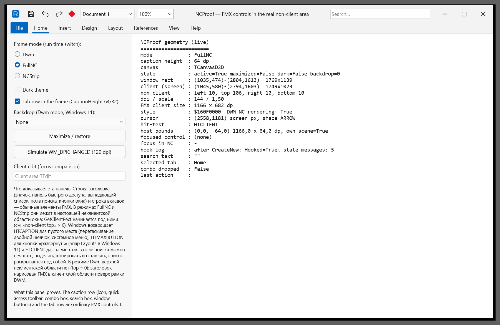
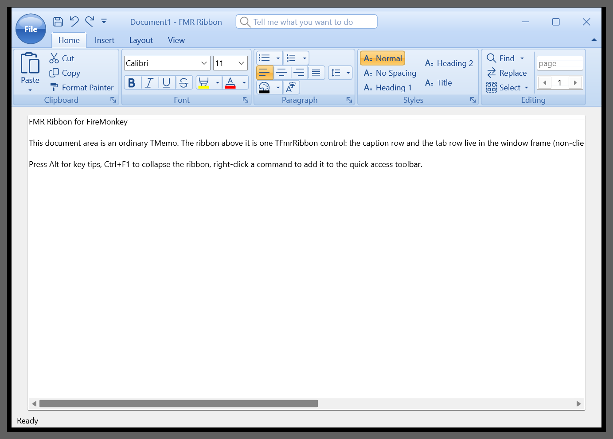
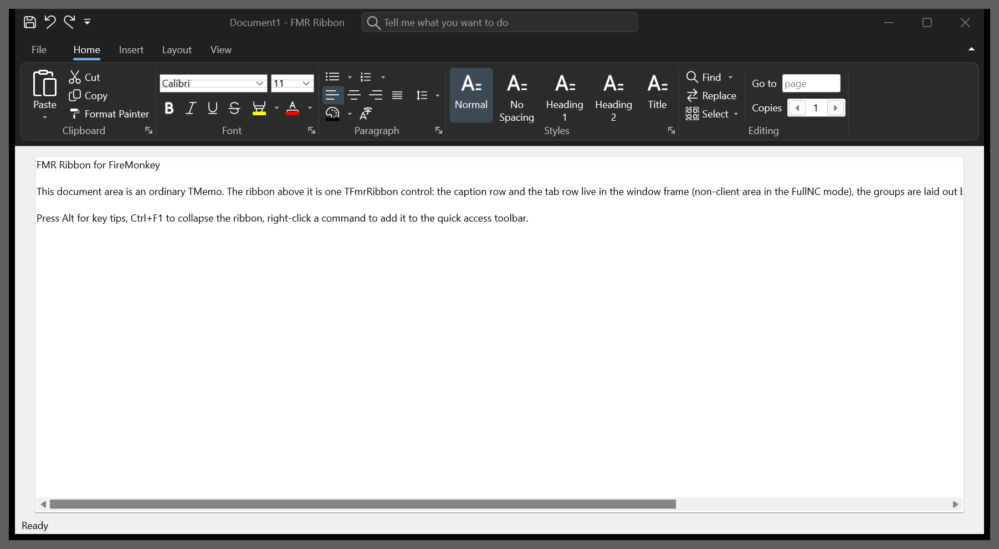
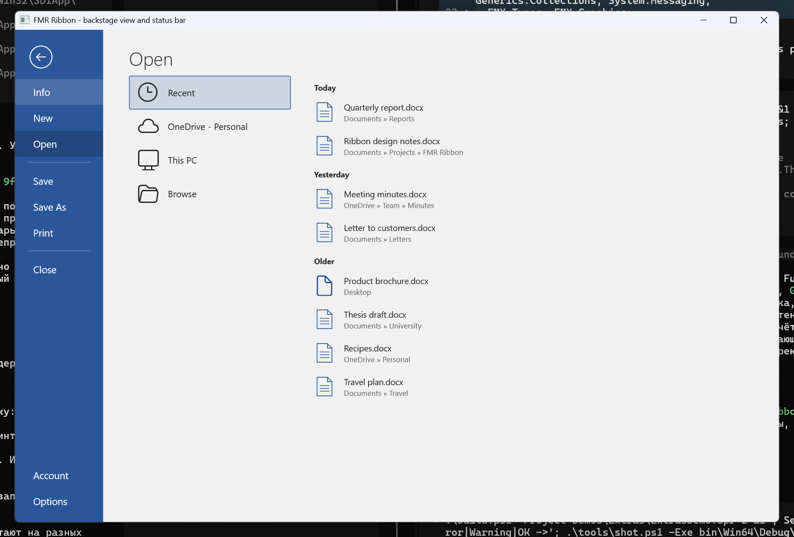
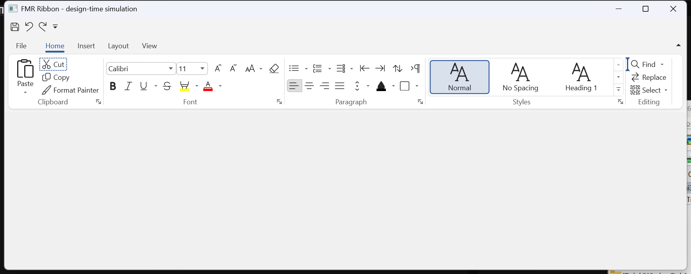

# Status

State of FMR Ribbon at the end of the first development round (2026-10-14). Everything below was built and
checked on Windows 11 25H2, 150 % DPI, Delphi 13 (37.0), Win64 and Win32.

## Screenshots

| | |
|---|---|
|  |  |
| FMR Write (Office 365 Colorful, FullNC frame) | NCProof: FMX controls in the real non-client area, live geometry |
|  |  |
| Office 2007 Blue, orb, reduced Styles group | Windows 11 Dark, Dwm frame |
|  |  |
| Backstage view (Office 2016 Colorful) | Design-time simulation: selection frame and insertion mark |

## Done

| Area | State | Verified by |
|---|---|---|
| Frame: FullNC (default), Dwm (+ Mica/Acrylic/Tabbed), NCStrip, switch at run time | done | NCProof screenshots, `tools\shot.ps1` geometry and hit-test probes (`Docs\FRAME.md`) |
| FMX controls in the non-client area: typing, selection, clipboard, drop-down lists, hints, cursor | done | NCProof screenshots |
| Window behavior: drag, double-click maximize, system menu, Snap Layouts, sizing borders, maximize into work area | done | NCProof |
| Bar manager, items, links, actions, image sources (ImageList, SVG, icon font, path) | done | 33 unit tests |
| Ribbon structure, streaming of tabs/groups/links/context groups | done | unit tests; FMR Write loads its whole form from `.fmx` |
| Layout calculator: reduction, collapse, galleries, simplified overflow, RTL mirroring | done | 31 unit tests; screenshots at several widths |
| Ribbon control: caption/tab rows in the frame host, groups, every button kind, editor controls, contextual tabs, QAT above/below, minimized, auto-hide, simplified, touch, RTL, command search | done | RibbonBasic, Customize, WordLike screenshots |
| Popups and menus, collapsed group popups, key tips (incl. non-Latin layouts), screen tips | done | screenshots and driven interactions |
| Galleries (in-ribbon, drop-down, filter, resize, live preview), color gallery, styles gallery | done | RibbonBasic, WordLike |
| Office 2007 application menu, backstage view, status bar, mini toolbar, radial menu | done | screenshots |
| Customization dialog (ribbon + QAT), JSON layout, import/export/reset | done | 14 model tests, screenshots |
| Ribbon merge | done | 11 unit tests, Showcase merge page |
| 18 themes, accent colors, StyleBook token overrides | done | ThemeSheet renders, screenshots |
| Localization EN/RU | done | tests, WordLike in Russian |
| UI Automation provider (tabs, groups, buttons, editors with Value) | done (basic) | `Demos\Customize\uia-test.ps1` |
| Packages (runtime + design, Win32/Win64), registration, property and component editors, items and structure editors, image picker, templates | done | compiled with 0 warnings, `LoadPackage` test, DesignPreview screenshots |
| In-form design (tab click, selection, drag & drop, insertion marks, drop from items editor) | done | `DesignPreview /realtest`: 45/45 checks with the real ribbon in design state |
| Demos: NCProof, RibbonBasic, WordLike, Showcase, Extras, Customize | done | screenshots, leak check on close |
| Tests | 169 DUnitX tests pass on Win64 and Win32, no leaks (model and layout; theme contrast of every text token; the real `TFmrRibbon` without a window: destroy orders, deleted items, key tips) | `Tests\FmrRibbonTests.dpr` |
| Stress and destroy paths (QA round, 2026-10-14) | 25 scenarios pass on Win64/Win32, Debug/Release: 50 theme switches, frame modes with maximize/restore, 50 popup and key tip cycles, display modes, ribbon or manager freed first, manager set to nil, items/groups/tabs deleted while hot, pressed or shown in open menus, form closed with each kind of popup open, frame/application menu/backstage/mini toolbar/radial menu freed while open, unknown theme, StyleBook set/freed, focus after menus and deactivation; GDI, USER and heap do not grow; no leak report | `tools\Stress\FmrStress.dpr` |

## Not verified (no environment here)

- Inside the real RAD Studio IDE: the design package was compiled and loaded with `LoadPackage`, and the in-form
  designer was driven in a simulation that sets the design state like the IDE does. How the IDE form designer
  actually routes mouse events, selection order, zoomed designer views — see `Docs\DESIGNTIME.md`.
- Windows 10 (documented from knowledge in `Docs\FRAME.md`), several monitors with different DPI (a simulated
  `WM_DPICHANGED` works), auto-hide taskbar, a real IME composition (caret and candidate positions were checked),
  screen readers (Narrator/NVDA) with the UIA provider.

## Known limitations

- FullNC: no system minimize/maximize animations by default (Windows animates only windows with a caption style);
  opt-in `FmrWinFullNCStrategy := CaptionDuringAnimation` restores them for commands from the caption buttons.
- Controls inside the caption host can't be rotated/scaled by the form designer and aren't designable there (the
  ribbon creates its own rows; a standalone caption is built in code).
- While an editor inside a popup has focus, the main window's caption looks inactive.
- RTL: text inside FMX edit/combo controls stays left-to-right; the customization dialog is not mirrored; undo/redo
  icons are not flipped.
- UIA: no focus/change events, popups/backstage/customization dialog are not exposed.
- Layout files don't store designed tabs/groups without a `Name`; user-defined group glyphs are stored only as
  image-list indexes.
- Other platforms: the frame units compile for macOS (not linked, no SDK here); the ribbon was not built or run on
  macOS, iOS, Android or Linux.
- Popup contents written by an application (own `IFmrPopupContent` controls) are closed when an item or link they
  show is destroyed only if they implement `IFmrItemDisplay`; the library's menus, color palettes and drop-down
  galleries do.
- `BarManager := nil` at run time does not hide the commands: links reference their items directly, so the views
  stay (without the manager's image list and change notifications) until the links or items go away.
- Office 2007 themes: the top-level key tips of the quick access toolbar hang over the tab captions (as in Office
  2007); the "File" text on the glass orb has a gradient behind it (lower contrast than a flat button).
- Many theme switches without processing messages in between (a loop in code) queue their repaint work; memory is
  given back as soon as the message loop runs.
- Not verified by automation: real mouse double-click on the non-client caption (the drive tool posts client
  messages only; maximize/restore was checked through the system menu) and the per-monitor DPI move between the
  two monitors of the test machine.

## Next steps

1. Install the design package in the IDE and go through `Docs\DESIGNTIME.md` (the checklist names what to confirm).
2. Test on Windows 10, with multiple monitors and with a screen reader.
3. Fill the gaps above (UIA events, RTL in editors, layout of unnamed objects).
