# FMR Ribbon для Delphi FireMonkey

Лента (ribbon) в стиле Microsoft Office для FireMonkey: вкладки, группы с адаптивным сжатием, галереи, Backstage,
меню приложения Office 2007, QAT, KeyTips, ScreenTips, настройка пользователем, 21 тема — и **настоящая неклиентская
область окна**: строка заголовка и строка вкладок могут жить в NC-области (`WM_NCCALCSIZE` / `WM_NCPAINT`), при этом
в них лежат обычные FMX-контролы — кнопки, `TEdit`, `TComboBox`, что угодно.

[English version](README.md)

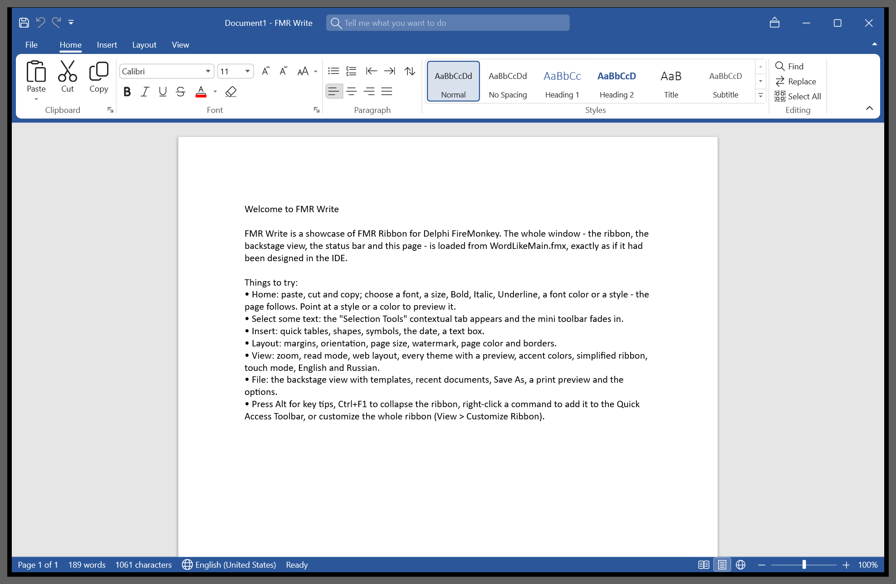

## Главное

- **FMX-контролы в настоящей NC-области.** Режим рамки `FullNC` (по умолчанию): `GetClientRect` начинается под
  строкой вкладок, а в заголовке работают ввод текста, выделение, буфер обмена, выпадающие списки, подсказки,
  перетаскивание окна за пустое место, двойной щелчок, системное меню, Snap Layouts Windows 11 на кнопке «развернуть».
  Тень и скруглённые углы Windows 11 сохраняются. Ещё два режима: `Dwm` (как Office: клиентская область поверх
  расширенной рамки, Mica/Acrylic) и `NCStrip` (системный заголовок + NC-полоса под ним). Переключаются на лету.
  Доказательство — демо `Demos\NCProof` с живой панелью геометрии окна и hit-test (`Docs\FRAME.md`).
- **Модель как у DevExpress:** `TFmrBarManager` с элементами и ссылки (`TFmrItemLink`) на них в группах, QAT, меню,
  mini toolbar; один элемент — во многих местах. Элементы лёгкие (не контролы): сотни команд без тормозов.
- **Лента:** вкладки, контекстные вкладки, группы с адаптивным сжатием (большие → малые с текстом → малые →
  свёрнутая группа), кнопки всех видов (check, radio, dropdown, split, группы кнопок), встроенные контролы (edit,
  combo, spin, check, track bar, выбор шрифта и цвета, любой `TControl`), свёрнутый режим, AutoHide, Simplified
  (однострочная лента Office 365), Touch, RTL, поиск команд в заголовке («Что вы хотите сделать?»).
- **Галереи** в ленте и выпадающие (группы, фильтр, изменение размера, живой предпросмотр), галерея цветов Office,
  галерея стилей с owner-draw.
- **Backstage view** (Office 2010+) и **меню приложения** Office 2007 с последними документами.
- **QAT** над/под лентой, **KeyTips** (Alt / F10, многоуровневые, работают и на русской раскладке), **ScreenTips**,
  **mini toolbar**, **radial menu**, **строка состояния** (масштаб, кнопки режимов).
- **Настройка пользователем:** форма «Настроить ленту» / «Панель быстрого доступа», сохранение и загрузка раскладки
  в JSON, импорт/экспорт, сброс; **слияние лент** (merge).
- **Темы:** Office 2024 (Light, Dark Gray, Dark: вид Microsoft 365, снятый с Word, с эффектом неактивного окна
  в строке заголовка), Office 365 (Colorful, White, Dark Gray, Black), Office 2016, 2013, 2010, 2007 (Blue, Silver,
  Black), Windows 11 Light/Dark; любой акцентный цвет; переопределение любого токена через StyleBook (`Docs\STYLES.md`).
- **Иконки:** `TImageList`, SVG (Skia), глифы иконочных шрифтов (Segoe Fluent Icons; где его нет, те же иконки
  берутся из встроенного шрифта «FMR Fluent Icons» на основе Fluent UI System Icons от Microsoft, MIT), `TPathData`.
- **Linux** (FMXWayland — нативный Wayland-бэкенд FMX): все runtime-модули компилируются под Linux64, RibbonBasic и
  Showcase работают (`Docs\LINUX.md`).
- **Дизайнер IDE:** пакеты, редакторы элементов и структуры, выбор иконки, шаблоны (Word, Excel, простой), темы из
  контекстного меню; щелчок по вкладке, выделение элементов и drag&drop на форме (`Docs\DESIGNTIME.md`).
- **Локализация** EN/RU (`FmrSetLanguage('ru')`), **UI Automation** (экранные дикторы, автотесты),
  работает со штатным канвасом FMX и с FastCanvas (GPU-канвас на Direct3D 11/12).

## Темы

Одна и та же лента (`Demos\RibbonBasic`, рамка FullNC) в 13 из 21 встроенной темы. Тема переключается на лету свойством `TFmrRibbon.Theme`, `AccentColor` перекрашивает любую из них. Картинки пересоздаются скриптом `tools\theme-shots.ps1`.

| | |
|---|---|
| 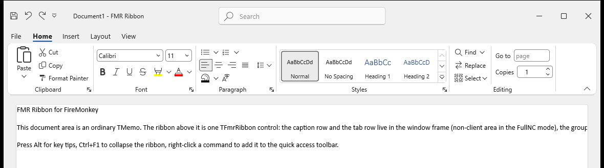 | 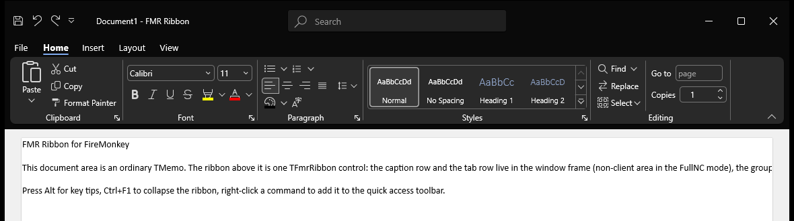 |
| `Office2024Light` — Office 2024 Light | `Office2024Dark` — Office 2024 Dark |
| 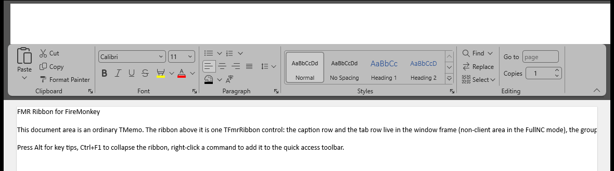 | 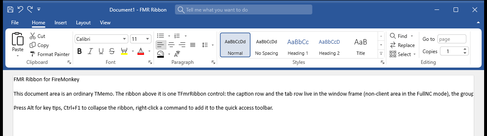 |
| `Office2024DarkGray` — Office 2024 Dark Gray | `Office365Colorful` — Office 365 Colorful |
|  | 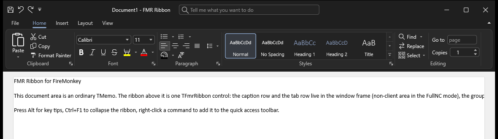 |
| `Office365White` — Office 365 White | `Office365Black` — Office 365 Black |
| 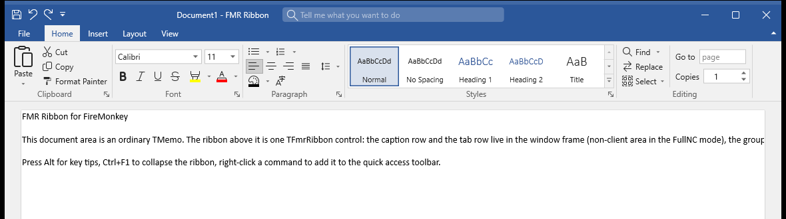 | 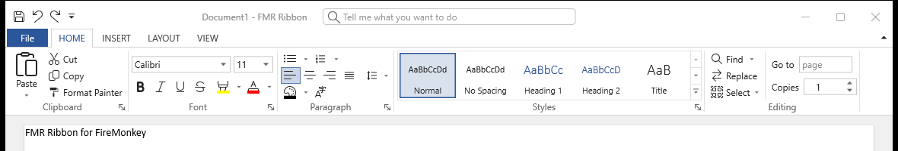 |
| `Office2016Colorful` — Office 2016 Colorful | `Office2013White` — Office 2013 White |
| 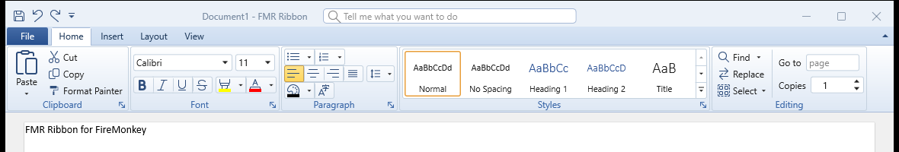 | 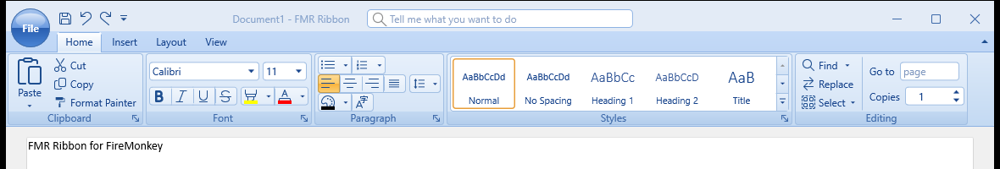 |
| `Office2010Blue` — Office 2010 Blue | `Office2007Blue` — Office 2007 Blue |
| 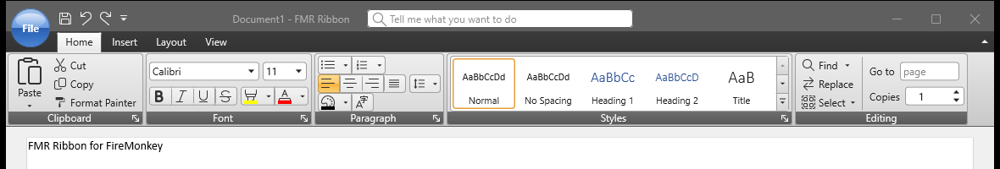 |  |
| `Office2007Black` — Office 2007 Black | `FluentLight` — Windows 11 Light |
| 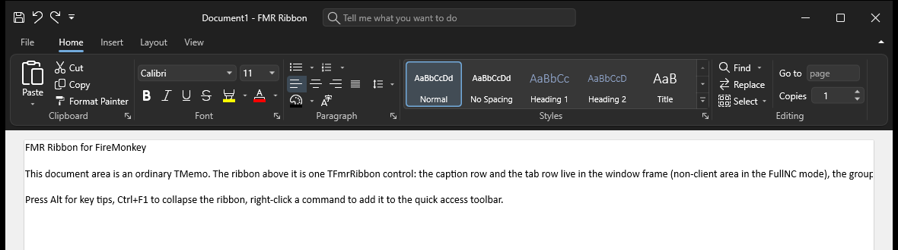 |  |
| `FluentDark` — Windows 11 Dark |  |

## Требования

- Delphi 13 (RAD Studio 37.0) или новее, FireMonkey; Win64 и Win32; Linux64 с FMXWayland.
- Windows 10/11 для интеграции с рамкой окна; ядро ленты кроссплатформенное (на других платформах заголовок и
  вкладки рисуются внутри ленты).

## Linux

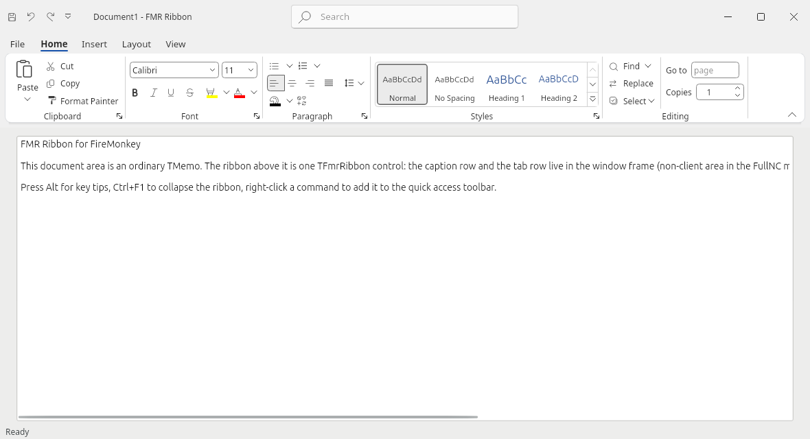

| | |
|---|---|
| 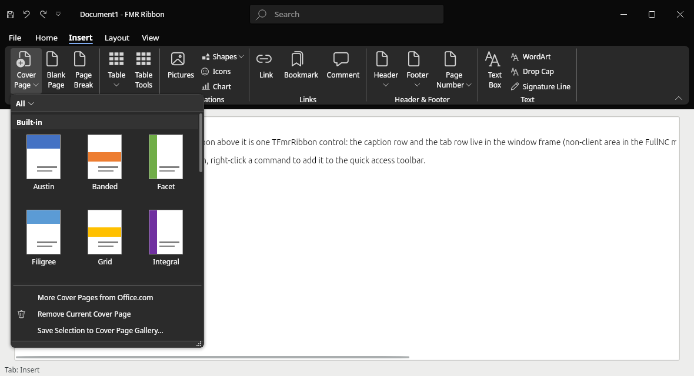 | 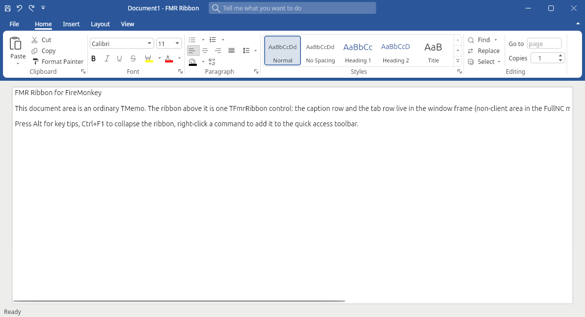 |

FMR Ribbon работает в Linux на FMXWayland (нативная Wayland-платформа FMX без libfmux; канвас Skia):

```powershell
.\build.ps1 -Project Demos\RibbonBasic\RibbonBasic.dpr -Platform Linux64      # -FmxWayland <папка> -Sdk <Linux SDK>
.\tools\linux-run.ps1 -Exe bin\Linux64\Debug\RibbonBasic -Arguments '/theme=Office2024Dark' -Shots 6
```

Программа ставит `GlobalUseSkia := True` и поставляется с `libsk4d.so` и `fonts/FmrFluentIcons.ttf` (build.ps1
кладёт их рядом). Темы берут установленный UI-шрифт (Noto Sans, Cantarell, DejaVu Sans…), коды Segoe-иконок рисуются
из встроенного шрифта, список шрифтов — из fontconfig. С сервисом рамки окна FMXWayland (`IFMXWaylandWindowFrame`,
пока в его ветке `windowframe`, до слияния) строка заголовка и вкладки ленты встают на место заголовка окна, как на
картинках выше (перемещение, изменение размера, разворачивание и меню окна делает композитор); без сервиса лента стоит
под собственным заголовком FMXWayland. Подробности в `Docs\LINUX.md`.

## Установка

```
tools\build-packages.ps1            # FMRRibbon (runtime) и dclFMRRibbon (design) для Win32 и Win64
tools\build-packages.ps1 -Install   # зарегистрировать design-пакет в IDE
tools\build-packages.ps1 -Platform Linux64   # runtime-пакет для Linux64 (программы на FMXWayland линкуются статически)
```

или откройте `Packages\FMRRibbon.groupproj` в IDE, соберите оба пакета и установите `dclFMRRibbon`. В путь поиска
проекта добавьте папки `Source\*` (или используйте runtime-пакет). Компоненты — на странице палитры «FMR Ribbon».

## Быстрый старт (в коде)

```pascal
uses
  FMR.Frame, FMR.Frame.Types, FMR.Bars, FMR.Bars.Items, FMR.Ribbon.Structure, FMR.Ribbon;

procedure TMainForm.FormCreate(Sender: TObject);
var
  Manager: TFmrBarManager;
  Ribbon: TFmrRibbon;
  Paste: TFmrButtonItem;
  Home: TFmrRibbonTab;
begin
  TFmrFormFrame.Create(Self).Mode := TFmrFrameMode.FullNC;   // заголовок и вкладки — в NC-области

  Manager := TFmrBarManager.Create(Self);
  Manager.Parent := Self;
  Paste := TFmrButtonItem(Manager.CreateItem(TFmrButtonItem, 'btnPaste'));
  Paste.Caption := 'Вставить';
  Paste.LargeGlyph.GlyphCode := $E77F;                       // глиф Segoe Fluent Icons

  Ribbon := TFmrRibbon.Create(Self);
  Ribbon.Parent := Self;
  Ribbon.BarManager := Manager;
  Ribbon.Theme := 'Office365Colorful';
  Home := Ribbon.AddTab('Главная', 'tabHome');
  Home.AddGroup('Буфер обмена').ItemLinks.AddItem(Paste);
end;
```

В дизайнере: положите на форму `TFmrBarManager`, `TFmrRibbon` и `TFmrFormFrame`, примените шаблон из контекстного
меню ленты («Apply template…») или добавьте вкладки, группы и команды через редактор структуры.

## Демо

| Демо | Что показывает |
|---|---|
| `Demos\NCProof` | FMX-контролы в настоящей NC-области, три режима рамки, живая геометрия окна и hit-test |
| `Demos\RibbonBasic` | лента как в Word: все виды кнопок, галереи, меню приложения, mini toolbar, radial menu |
| `Demos\WordLike` | «FMR Write» — приложение-витрина, форма из `.fmx` (загрузка из ресурса как из дизайнера) |
| `Demos\Showcase` | страница на каждую возможность, переключение тем и режимов |
| `Demos\Extras` | Backstage view и строка состояния |
| `Demos\Customize` | форма настройки, AutoHide, Simplified, RTL, UI Automation |

Сборка из командной строки: `.\build.ps1 -Project Demos\RibbonBasic\RibbonBasic.dpr` (результат — в
`bin\Win64\Debug`). Ключи демо описаны в `Demos\README.md`.

## Документация

| Файл | О чём |
|---|---|
| `Docs\ARCHITECTURE.md` | решения и устройство библиотеки |
| `Docs\FRAME.md` | рамка окна и NC-область: как работает каждый режим, результаты проверок |
| `Docs\CORE.md` | менеджер, элементы и ссылки, структура, расчёт раскладки, сохранение, merge, KeyTips |
| `Docs\RIBBON.md` | контрол ленты, попапы, KeyTips, интеграция с рамкой |
| `Docs\GALLERIES.md` | галереи, меню приложения, mini toolbar, radial menu |
| `Docs\EXTRAS.md` | Backstage view, строка состояния |
| `Docs\CUSTOMIZATION.md` | настройка пользователем, режимы отображения, RTL |
| `Docs\STYLES.md` | темы и токены StyleBook |
| `Docs\DESIGNTIME.md` | пакеты, установка, редакторы IDE |
| `Docs\ACCESSIBILITY.md` | UI Automation |
| `Docs\LINUX.md` | Linux с FMXWayland: сборка, запуск, что работает, контракт рамки окна |
| `Docs\STATUS.md` | что готово, что проверено, известные ограничения |

## Тесты

```
.\build.ps1 -Project Tests\FmrRibbonTests.dpr
bin\Win64\Debug\FmrRibbonTests.exe
```

Нагрузочные проверки настоящей ленты на настоящих окнах (циклы смены тем, режимов рамки и отображения с замером
GDI, USER и кучи; попапы открываются и закрываются; компоненты освобождаются в любом порядке; код выхода — число
ошибок):

```
.\build.ps1 -Project tools\Stress\FmrStress.dpr
bin\Win64\Debug\FmrStress.exe /log=stress.log
```

## Лицензия

MIT, см. [LICENSE](LICENSE). Сторонние компоненты (Fluent UI System Icons в `Assets\Fonts`):
[THIRD_PARTY_NOTICES.md](THIRD_PARTY_NOTICES.md).
